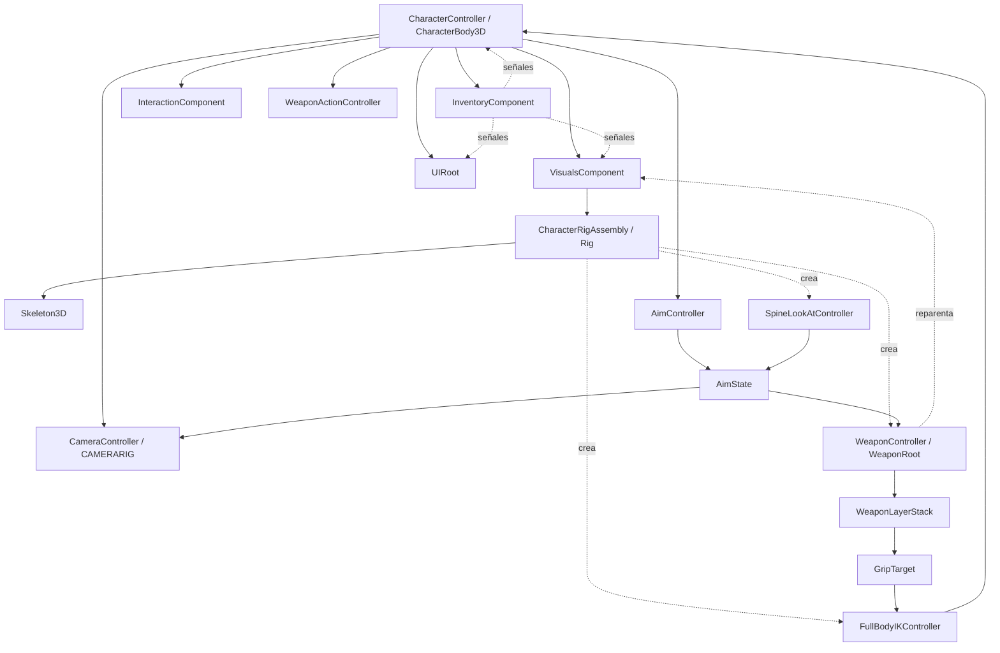

# Auditoría Técnica — Project2026

> [!info] Cómo leer este documento
> Auditoría **de solo lectura**. No se modificó ningún archivo, escena, script, configuración ni recurso para producir este informe. Toda afirmación relevante cita `archivo:línea` o nodo.
>
> Etiquetas de evidencia:
> - **`FACT`** — verificado en fuente/escena/recurso o en ejecución.
> - **`INFERENCE`** — conclusión derivada de varios hechos.
> - **`HYPOTHESIS`** — explicación plausible, no demostrable solo con análisis estático.
>
> Tipos de hallazgo: `BUG` · `PROBABLE_BUG` · `RISK` · `INCONSISTENCY` · `TECH_DEBT` · `VALID_BUT_UNUSUAL` · `INCOMPLETE` · `UNDETERMINABLE` · `DEAD_CODE`.

---

## 0. Metadatos y alcance

| Campo | Valor |
|---|---|
| Proyecto | Project2026 |
| Motor | Godot 4.7.2 (binario) — `project.godot` declara feature `"4.7"` |
| Escena principal | `res://World/testing_world.tscn` |
| Lenguaje | GDScript |
| Volumen de código de juego | ~12.500 líneas |
| Autoloads | Ninguno |
| Tooling externo | `addons/godot_ai` (agente Ziva) — **no** es código de juego |

**`FACT`** No se encontraron `TODO`/`FIXME`/`HACK` en el código de juego.
**`FACT`** Evidencia de runtime obtenida ejecutando el smoke test existente en headless:
`godot --headless --script res://Tests/Smoke/dependency_smoke_runner.gd` → **exit=1, 4 asserts fallidos** (ver §7).

---

## 1. Resumen ejecutivo

**`FACT`** El proyecto es un **framework de personaje 3D (TPS/FPS conmutable)** centrado en: movimiento, cámara, apuntado (ADS), posicionamiento de arma, IK de esqueleto e inventario/equipamiento basado en grafo.

**`FACT`** Está claramente **a mitad de una migración arquitectónica mayor**. El directorio `plans/` documenta un rediseño por fases (00–06); el último commit es `62dfad7 "feat: replace legacy IK with full spine-weapon IK pipeline"`. Hay **cambios sin commitear** que borran toda la documentación funcional, un modelo (`Player/mastercharacter.tscn`) y dos perfiles de arma, además de reescribir 8 scripts del Player.

**`FACT`** El smoke test propio **falla con 4 asserts** y el runtime emite errores de null-reference en `FullBodyIKController`. **El estado en disco NO está verde.**

**`INFERENCE`** Un desarrollador senior nuevo encontraría:
- un núcleo Player moderno (AimState → layers → GripTarget → IK, bien comentado, con invariantes explícitos);
- conviviendo con capas legacy deshabilitadas pero presentes (`WeaponPositionController`, `WeaponOffsetCache`, `EquipmentSlotCatalog`);
- múltiples fuentes de verdad en inventario;
- sistemas periféricos muertos (TerrainGen, scripts sueltos, tooling de graphify stale);
- andamiaje multiplayer parcial no soportado por el tier actual.

---

## 2. Estructura del proyecto

**`FACT`** Raíz del proyecto:

```
project.godot            → main_scene = res://World/testing_world.tscn
AGENTS.md                → guía de arquitectura del proyecto (contexto IA)
plans/                   → 7 docs de rediseño arquitectónico (00–06)
project-docs/            → VAULT DE OBSIDIAN (este documento vive aquí)
project-docs/docs/       → documentación funcional DELETADA en working tree (git: D)
graphify-out/            → salida de herramienta "graphify" (paths Windows stale)
addons/godot_ai/         → tooling del agente (NO juego)
Player/                  → núcleo del personaje + Debug UI + GLBs + Textures
World/                   → escenas del mundo + sistema Items (inventario/attachment)
Tools/CharacterTuner/    → herramienta de autoría de rigs
Procedural Generation/   → TerrainGen.gd (stub muerto)
Tests/Smoke/             → runner de smoke (SceneTree)
Debug/weapon_diag.log    → artefacto de log (gitignored)
scratch/, list_anims.gd, check_glb.gd, TerrainGen.tscn → residuos
```

**`FACT`** No hay `[autoload]`. Solo un grupo global: `[global_group] Player=""` (`project.godot:22`).
**`FACT`** Ningún script hace `get_nodes_in_group` — el grupo `Player` está declarado pero **no se consulta**. *(`INFERENCE`: por convención/futuro, hoy sin uso.)*

**`FACT`** 60 `class_name` en código de juego; 60 scripts. No hay `.cs`, ni shaders propios.

### 2.1 Desajuste de versión `FACT`
- `project.godot:19` → `config/features=PackedStringArray("4.7", ...)`; binario `4.7.2`.
- `AGENTS.md` y `plans/01` dicen **Godot 4.6.1**.
- `Debug/weapon_diag.log:3` → header "Engine: Godot 4.6.1-stable".
- **`INFERENCE`**: migración reciente 4.6.1 → 4.7; documentación y comentarios quedaron atrás. **Riesgo bajo**, pero confunde al reincorporarse.

---

## 3. Arquitectura general

El núcleo Player **implementa explícitamente** un patrón equivalente al objetivo documentado en `plans/02`:

```
Input → AimController → AimState → (consumido, nunca escrito por los consumidores)
                                    ├─ CameraController (FOV / ADS)
                                    ├─ WeaponController → WeaponLayerStack → GripTarget → FullBodyIKController
                                    ├─ SpineLookAtController
                                    └─ WeaponActionController
```

**`FACT`** `AimState` (`AimState.gd`) es un `RefCounted` con campos serializables + `to_dictionary()` / `from_dictionary()` — diseñado para red, pero **hoy no se replica**. `AimController` produce un `AimState` nuevo cada `_process` (`_build_aim_state`, `AimController.gd:136`).

**`FACT`** Existe una **segunda arquitectura, legacy y deshabilitada**, para posicionar el arma: `WeaponPositionController` (768 líneas) + `WeaponOffsetCache`, que escribían `set_bone_global_pose_override` sobre `ik_hand_gun`. Ambas están desconectadas de `CharacterRigAssembly` (creación comentada, `CharacterRigAssembly.gd:35,42`) y `WeaponPositionController._disabled = true` (`:63`).
→ **`INFERENCE`**: conviven dos generaciones (legacy por bone-override vs nueva por `WeaponRoot`/layers).

---

## 4. Sistemas principales

### 4.1 CharacterController (`Player/Scripts/CharacterController.gd`, 614 líneas)
- **Responsabilidad**: movimiento, input, estado de aim/sprint/stamina, selección de estado de animación, quick-actions de inventario, creación de armas tiradas al suelo.
- **Dependencias resueltas por nombre de hijo** (`_resolve_dependencies`, `:501`): `InventoryComponent`, `InteractionComponent`, `VisualsComponent`, `CAMERARIG`, `VisualsComponent/Rig/AnimationTree`; `AimController` como hijo (`:544`); `FullBodyIKController` vía `ik_controller_path` (`:536`).
- **Estado autoritativo**: `input_vector`, `intent_direction`, `target_velocity`, `target_yaw`, `camera_yaw`, `is_first_person`, `is_aiming`, `is_sprinting`, `stamina`, `load_factor`.
- **Problema clave `FACT`**: `_physics_process` ejecuta gameplay + presentación (`_update_animation()` y `_update_visuals()` — este último es `pass`, `:368`).
- **`FACT`**: `_update_body_yaw()` (`:259`) deriva yaw del `AimState`; pero en FPS `_update_rotation()` (`:275`) aplica `rotation.y = target_yaw` directo, y `target_yaw` proviene de la cámara → **conflicto de autoridad de yaw** (P1/ADR-11 documentado).

### 4.2 CameraController (`Player/Scripts/CameraController.gd`, 373 líneas)
- **Responsabilidad**: input de mouse, look FPS/TPS, anclaje de pivot FPS al hueso cabeza (`get_eye_world_position`), cámara debug free-fly.
- **`FACT`**: escribe `motor.set_camera_yaw(...)` / `motor.set_camera_mode(...)` (`:291-292`). **No** escribe `set_target_yaw` (comentario `:289`).
- **`FACT`**: expone `fps_pitch`/`tps_pitch` públicos (leídos por `SpineLookAtController` y por el legacy `WeaponPositionController`).
- **`FACT`**: se auto-conecta al `InventoryViewController` por `get_tree().root.find_child("InventoryViewController", true, false)` (`:298`) — **lookup global**.

### 4.3 AimController + AimState (`AimController.gd` 185 · `AimState.gd` 78)
- **Responsable único** del aiming intent. `_process` (`:79`) lee `character_controller.is_aiming`, calcula basis/dirección/ADS weight/FOV y emite el state.
- **`FACT`**: `aim_origin`/`eye_position` provienen de `visuals_component.get_eye_world_position()` (hueso cabeza) — desacoplado del pivote de cámara (`:152-163`, ADR-12).
- **`FACT`**: `state.aim_direction` se reconstruye desde `look_pitch`/`look_yaw` con bases (`:166-168`).
- **`INCOMPLETE`**: `set_ads_profile` (`:51`) **no tiene llamadores**. El sistema de ADS por arma está definido en datos pero no cableado.

### 4.4 WeaponController + LayerStack (`WeaponController.gd` 558 · `WeaponLayerStack.gd` 70 · `WeaponLayer*`)
- **`FACT`**: `WeaponController` es un `Node` **creado en runtime** por `CharacterRigAssembly._deferred_weapon_root_setup` (`:140-153`), hijo de `WeaponRoot` (también runtime, bajo `CharacterBody3D`). **No está en ningún `.tscn`**.
- **Flujo**: `_process` (`:98`) → `_layer_stack.compose(state, delta)` → `weapon_root.global_transform = weapon_xform` → `_build_grip_target` → `_fullbody_ik.apply_grip_target(grip)`.
- **Layers**: `WeaponLayerBase` (prio 0), `WeaponLayerAim` (prio 5), `WeaponLayerADS` (prio 10).
- **`FACT`**: la pila documenta orden completo `base(0) → aim(5) → ADS(10) → recoil(20) → sway(25) → inertia(30) → breath(35) → bob(40) → constraint(90)` (`WeaponLayer.gd:9-10`), pero **solo existen base/aim/ADS**. El resto no implementado.
- **`FACT`**: `_on_visual_attached` (`:213`) **reparenta** el visual del arma bajo `WeaponRoot` — acoplamiento fuerte inventario→visual→arma.
- **`FACT`**: `_build_grip_target` (`:191`) multiplica `weapon_xform * marker_local`; si falta un marker queda `IDENTITY` y el componente **no se setea**, pero `is_valid = true` igual (`:203`) → GripTarget "válido" con posiciones cero. (Ver §7 B8.)

### 4.5 FullBodyIKController (`464`) + SpineLookAtController (`331`)
- Ambos `SkeletonModifier3D` **creados en runtime** (hijos de `Skeleton3D`).
- **`FACT` `FullBodyIKController`**: consume `GripTarget`, configura `TwoBoneIK3D` de brazos y `CCDIK3D` de cabeza, blending de `influence` por estado (`WEIGHTS_UNARMED/ARMED/AIMING`).
- **`FACT` `SpineLookAtController`**: configura el `CCDIK3D` "CCDIK" (spine_01→spine_02), mueve `Node3D LookAtTarget`, ajusta iteraciones según delta de pitch.
- **`FACT` crítico**: `_process_modification_with_delta` de `FullBodyIKController` **no guarda** `_character_controller == null` antes de `has_main_hand_weapon()` (`:279`) → null-ref confirmado en runtime.

> **Corrección 2026-10-14 (sin reescritura del original).** Los dos `FACT` de arriba describen un estado que ya no existe:
> - `SpineLookAtController` **ya no configura ningún `CCDIK3D`**. El solver de columna se retiró (ADR-0008): ningún `SkeletonModifier3D` escribe huesos en esta versión del motor, y la vía vigente es escritura procedural desde `_process` (`SpineLookAtController._write_spine_pose`). Tampoco ajusta iteraciones: esa lógica se eliminó.
> - `FullBodyIKController` **sí sigue configurando** `TwoBoneIK3D` y `CCDIK3D`, y sus pesos se calculan correctamente — pero **los solvers son inertes**: medido, desplazar `RightHandIKTarget` 1 m produce `0.000000 m` de movimiento en `hand_r`. El error de agarre resultante (9.56 cm derecha, 55.85 cm izquierda) viene del clip, no del controlador.
>
> El resto de la auditoría (superficie, nulos, acoplamiento) sigue vigente.

> **Corrección 2026-10-14 (T12, sin reescritura del original).** El bloque 4.5
> describe en su mayor parte código que ya no está en disco. A partir de T12
> (commit `83d5c86`) se borraron `FullBodyIKController.gd` entero, el
> `HeadCCDIK` y su `AimIKTarget`, medidos inertes. En consecuencia:
>
> - **`SpineLookAtController` es hoy el único `SkeletonModifier3D` del
>   esqueleto.** Ya no es «uno de dos»: `CharacterRigAssembly` crea únicamente
>   `LookAtTarget` y `SpineLookAtController`, y nada más.
> - **Las tablas de riesgos que citan `FullBodyIKController` como causa están
>   cerradas**: B1 (null-ref en `_compute_weight_targets`), B2 (rutas de
>   `AimController` desde el nodo), R3 (avisos de resolución en el Tuner) y el
>   grafo `GripTarget → FullBodyIKController` de §5. El nodo y los errores que
>   producía ya no se ejecutan; no hay nada que arreglar ahí.
> - **El riesgo de «múltiples escritores» (§13) queda reducido a dos**:
>   `AnimationTree` y la columna. La hipótesis que lo justificaba —que la
>   propiedad de los huesos no estaba impuesta por código— sigue siendo cierta,
>   pero ya no hay tres escritores compitiendo por ella.
> - **Lo único que este bloque acertó y que se mantiene** es el hallazgo de
>   fondo: en esta versión del motor **ningún `SkeletonModifier3D` escribe
>   huesos**. Se midió en ADR-0008, se confirmó al borrar el IK de brazos (T10)
>   y de nuevo al borrar el sector de cabeza (T12). Esa es la razón de todas las
>   bajas y el criterio para decidir si algo futuro vuelve.

### 4.6 VisualsComponent (`731`)
- **Responsable** de instanciar visuales equipados (`BoneAttachment3D` por slot + ContentRoot), cachear markers (LGRIP/RGRIP/SIGHT_BACK/SIGHT_FRONT/MUZZLE), visibilidad de cabeza en FPS, y API para el Tuner.
- **`FACT`**: se cablea por `bind_inventory` a `inventory_updated` y `equipment_visuals_changed` (`:295-304`).
- **`FACT`**: `_apply_first_person_head_visibility` pone **todos** los `MeshInstance3D` hijos directos del skeleton en `layers = 2` (o 1).

### 4.7 Sistema de Items/Inventario (`World/Items/`, ~2.900 líneas)
Núcleo: `InventoryComponent` (914) + `RuntimeAttachmentGraph`, `ItemInstance`, `ItemDefinition`, `ItemDefinitionRegistry` (cache estático), `EquipmentAttachmentModifier`, y UI en `Player/Scripts/Inventory*UI`.
La autoridad runtime es `InventoryComponent`; el grafo de attachment se reconstruye en cada mutación (`_recalculate`).

### 4.8 UI (`Player/Debug/UIRoot.gd` 345 + `Debug/Scripts/*`)
`UIRoot` (`CanvasLayer`) instancia por código todo el stack de inventario y el debug layer; conecta señales explícitas (`:213-219`).

### 4.9 Tooling
- `Tools/CharacterTuner/` (≈1.500 líneas): herramienta standalone; reusa `VisualsComponent` y el modelo de items pero añade `TunerRigPreset/Profile/Adapter`.
- `Tests/Smoke/dependency_smoke_runner.gd`: `extends SceneTree`, ejecución por `--script`.
- `Procedural Generation/TerrainGen.gd`: stub muerto.

---

## 5. Mapa de dependencias

Solo conexiones comprobables. Ciclos/ambigüedades marcados.



**Ciclos / acoplamientos débiles detectados `FACT`**
- `WeaponController → VisualsComponent` (visual, markers) · `VisualsComponent → InventoryComponent` (señales) · `InventoryComponent → WeaponController` (implícito vía `visual_state="held"` y reparent). **Ciclo de facto** alrededor de inventario↔visual↔arma.
- **`FACT`**: `SpineLookAtController` **ya no** lee `CameraController.fps_pitch` (usa `AimState.look_pitch`) — mejora respecto a `plans/01`. **`INFERENCE`**: parte del rediseño ya se aplicó.

---

## 6. Matriz de problemas (resumen)

> [!bug] Bloqueantes de trabajo
> `B1` · `B2` · `B3` · `B4` · `B5` — ver detalle en §7.

| ID | Sistema | Problema | Tipo | Severidad | Evidencia | Confianza |
|---|---|---|---|---|---|---|
| B1 | FullBodyIKController | Null-ref `_character_controller` | BUG | 🔴 HIGH | `:279` + runtime | Alta |
| B2 | CharacterRigAssembly | Asume `CharacterBody3D`/`AimController` | BUG | 🔴 HIGH | `:135`, `FullBodyIKController.gd:132` | Alta |
| B3 | Tests/Smoke | 4 asserts stale | TECH_DEBT | 🔴 HIGH | run headless | Alta |
| B4 | WeaponActionController | RPC sin peer | BUG | 🔴 HIGH | `:58,63,88` | Media-Alta |
| B5 | ADS | `set_ads_profile` sin cablear; `.tres` vacío | INCOMPLETE/DATA | 🔴 HIGH | `WeaponController.gd:172`, `TestWeaponADSProfile.tres` | Alta |
| AR1 | Weapon pipeline | Legacy + nuevo coexistentes | RISK | 🟠 MEDIUM | `CharacterRigAssembly.gd:35,42` | Alta |
| AR2 | Inventario | 3 fuentes de verdad de ocupación | RISK | 🔴 HIGH | §9 | Alta |
| AR4 | Wiring | Dependencias por nombre de hijo | RISK | 🟠 MEDIUM | `CharacterController.gd:501-509` | Alta |
| AR5 | Multiplayer | Andamiaje no soportado | RISK | 🟠 MEDIUM | `PlayerCharacter.tscn:67` | Alta |
| B6 | StatusClusterUI | `/root/UIRoot` inválido | BUG | 🟠 MEDIUM | `:54` vs `testing_world.tscn:41` | Alta |
| B7 | InventoryComponent | Div por `base_capacity` sin guarda | BUG | 🟡 LOW | `:475` | Alta |
| B8 | WeaponController | GripTarget válido con ceros | BUG | 🟡 LOW/MED | `:195-203` | Media |
| B9 | ItemDefinition/Inventory | `allowed_slots` vacío ambiguo | INCONSISTENCY | 🟠 MEDIUM | `:77-80` vs `InventoryComponent.gd:117` | Alta |
| DEAD | varios | Código muerto | DEAD_CODE | 🟡 LOW | §11 | Alta |
| DATA | UI/Inventory | Capacidades/slots duplicados | DATA | 🟠 MEDIUM | `InventoryOverlayUI.gd:348`, `InventoryConstants.gd` | Alta |
| PERF | Visuals/Inventory | Recorridos por frame | RISK | 🟡 LOW | `VisualsComponent.gd:54` | Media |

---

## 7. Bugs confirmados

| ID | Bug | Evidencia | Consecuencia |
|---|---|---|---|
| **B1** | Null-ref: `FullBodyIKController._compute_weight_targets` llama `_character_controller.has_main_hand_weapon()` sin comprobar null | `FullBodyIKController.gd:279`; reproducido: `SCRIPT ERROR: Invalid call. Nonexistent function 'has_main_hand_weapon' in base 'Nil'` (×3) | Errores por frame en contextos sin `CharacterController` (p.ej. Tuner). Stack de IK degradada. |
| **B2** | `CharacterRigAssembly` asume ancestro `CharacterBody3D` y rutas `AimController`; en el Tuner no existen | `CharacterRigAssembly.gd:135-136` (`CharacterBody3D not found`); `FullBodyIKController.gd:132` usa `get_node` (no `or_null`) → `Node not found: "../../../../../../AimController"` | El Tuner no crea `WeaponRoot` y emite errores duros; no bootea limpio. |
| **B3** | Smoke test desactualizado: falla 4 asserts | Run headless: `IK layout should expose Rig/Armature.` (`:89`), `...Rig/Armature/Skeleton3D.` (`:90`), `Backpack should accept a size-3 weapon.` (`:196`), `Belt should create a runtime visual entry.` (`:219`) | La validación está **roja**; no sirve como gate. |
| **B4** | `WeaponActionController` usa `rpc_id(1, "server_process_fire", ...)` y `@rpc` **sin peer** | `WeaponActionController.gd:58,63,88` | Errores de RPC al disparar en single-player. |
| **B5** | ADS por arma definido en datos pero **nunca cableado** | `ItemDefinition.weapon_ads_profile` (`:53`) sin consumidores; `set_ads_profile` sin llamadores (`WeaponController.gd:172`, `AimController.gd:51`); `TestWeaponADSProfile.tres` **vacío** | `WeaponLayerADS.apply` retorna temprano (`ads_pose == IDENTITY`) → ADS visual no opera. |
| **B6** | `StatusClusterUI` busca `/root/UIRoot` | `StatusClusterUI.gd:54`; árbol real `CharacterBody3D/UIRoot` (`testing_world.tscn:41`) | `layout_manager` null → sin layout responsivo. |
| **B7** | División por `base_capacity` sin guarda | `InventoryComponent.gd:475` (`load_factor`) | División por cero si se exporta `base_capacity = 0`. |
| **B8** | GripTarget "válido" con posiciones cero si faltan markers | `WeaponController.gd:195-203` | IK de manos puede quedar en 0 sin señalar error. (Hoy no se manifiesta: el M4 sí tiene markers.) |
| **B9** | Semántica contradictoria de `allowed_slots` vacío | `ItemDefinition.can_fit_in_slot` → `false` si vacío (`:77-80`); `can_attach_item` lo trata como "permitido" (`InventoryComponent.gd:117`); `supports_hand_slot` → false si vacío (`:115-116`) | Ruteo a manos inconsistente. |

**`FACT` adicional**: en la corrida headless aparecen `ERROR: 2 resources still in use at exit` — *(`INFERENCE`: recursos de escenas instanciadas por el test no liberados; menor).*

---

## 8. Bugs probables

- **PB1** `InteractionPromptData` es un `Resource` que **nunca se instancia**; los productores construyen `Dictionary` crudos (`WorldItem.gd:38`, `MountedItemInteractable.gd:31`, `InteractableEntity.gd:13`) y los consumidores leen claves de dict (`UIRoot.gd:110`, `InteractionPromptUI.gd:57`). → contrato de prompt inconsistente.
- **PB2** Doble `CollisionShape3D` en items tirados: `CharacterController._spawn_dropped_world_item` añade una (`:488-492`); `WorldItem._apply_world_visual` puede añadir otra si `world_visual_scene != null` (`WorldItem.gd:124-125`); `TestWeaponItem.tres` **sí** tiene `world_visual_scene`.
- **PB3** `_get_attachment_candidate_order` crea un `ItemInstance` throwaway en cada probe (`InventoryComponent.gd:745`) → consume IDs y puede saltar el guard de ciclo.
- **PB4** `InventoryComponent` API pública con parámetros sin tipo (`add_item`, `can_attach_item`, `attach_item`, `store_item_in_container`…). Errores en runtime, no en compile-time.
- **PB5** `CameraController._apply_active_look` asigna `fps_pivot.position = to_local(eye_world)` en FPS (`:280`) → posible jitter si el hueso cabeza se mueve con la IK. No reproducible estáticamente.
- **PB6** `WeaponController._cache_marker_locals_from_weapon` usa `affine_inverse()` sobre `weapon.global_transform` → inverso degenerado si escala 0 / fuera de árbol. Poco probable en flujo normal.

---

## 9. Riesgos arquitectónicos

> [!warning] Los tres riesgos de mayor impacto: AR1, AR2, AR5.

- **AR1 (🔴 ALTA)** Dos generaciones de posicionamiento de arma conviven: nueva (WeaponController/Layers) y legacy (`WeaponPositionController` 768 líneas + `WeaponOffsetCache`). Aunque deshabilitadas, **permanecen en disco** (imports, `class_name`, señales de debug).
- **AR2 (🔴 ALTA)** Estado autoritativo redundante en inventario: `RuntimeAttachmentNode.occupant_item_id` + `ItemInstance.owning_slot` + `slot_state[...]` (views de compatibilidad) mantenidos a mano (`_recalculate`, `_sync_compatibility_views`).
- **AR3 (🟠 MEDIA)** `WeaponController` reparentea el visual del arma durante el setup (`:230-234`) — efecto lateral fuerte y oculto.
- **AR4 (🟠 MEDIA)** Dependencias por **nombre de hijo** (`get_node_or_null("InventoryComponent")`, `"VisualsComponent"`, `"CAMERARIG"`, `"Rig/AnimationTree"`, `get_parent().has_method(...)`). Viola la regla AGENTS.md "no asumir jerarquía fija".
- **AR5 (🟠 MEDIA)** Andamiaje multiplayer parcial y no soportado: `MultiplayerSynchronizer` + `@rpc` + `is_multiplayer_authority()`. Solo "funciona" porque el juego es local.
- **AR6 (🟡 BAJA/MEDIA)** `CharacterController` es un God object parcial (movimiento + UI + inventario + animación + IK-debug + spawn de items; 614 líneas).
- **AR7 (🟡 BAJA)** Lookups globales: `get_tree().root.find_child(...)` (`CameraController.gd:298`), `/root/UIRoot` (`StatusClusterUI.gd:54`), `find_child("UIStyleProfile", ...)`.

---

## 10. Matriz de inconsistencias

| Área | Impl A | Impl B | ¿Intencional? | Evidencia | Riesgo |
|---|---|---|---|---|---|
| Emisión de señales | `emit_signal("x")` | `x.emit()` | No | §11 | Bajo |
| Tipado | Player/Core tipado | `World/Items` y UI sin tipos | Parcial | §11 | Medio |
| Prompt de interacción | `InteractionPromptData` (Resource) | `Dictionary` crudo | No | PB1 | Medio |
| Persistencia de slots | `RuntimeAttachmentGraph` | `slot_configs`/`slot_state` | Transición | `InventoryComponent.gd:443` | 🔴 Alto |
| Catálogo de slots | `AttachmentLayoutLibrary` (vivo) | `EquipmentSlotCatalog/Library/Definition` (sin uso) | No | §11 | Medio |
| Datos de capacidad | `base_capacity` | `20.0` hardcoded en UI | No | `InventoryOverlayUI.gd:348` | Medio |
| Escritura de huesos | legacy (off) | pipeline nuevo | Sí (migración) | §11 | 🔴 Alto si se re-habilita |
| Creación de nodos | runtime por código | estáticos en `.tscn` | Mixto | §11 | Medio |
| `class_name` | mayoría | `InventoryConstants`, `CharacterTunerUI` sin | No | §11 | Bajo |
| Nombres | archivo = clase | `InteractableEntity` → `WorldInteractable` | No | §11 | Bajo |
| Serialización de estado | `AimState.to_dictionary` (network-ready) | sin uso | Transición | §4.3 | Bajo |

**`INFERENCE` transversal**: la diferencia de estilo correlaciona con **etapas**. El núcleo Player/aiming fue reescrito recientemente (tipado, invariantes, comentarios ADR); el sistema de items y la UI arrastran un estilo anterior (dicts, sin tipos, campos públicos mutados por UI).

---

## 11. Código legacy / transicional / muerto

### 11.1 Legacy / transicional
1. **Pipeline de arma legacy** — `WeaponPositionController.gd:1-10`: *"DISABLED as of Step 8.5.4 — WeaponController is sole authority… Kept for rollback reference. Do not re-enable without ADR."* Creación comentada (`CharacterRigAssembly.gd:42`). `WeaponOffsetCache.gd:57-59`: *"Disabled: Legacy offset cache no longer used"*.
2. **`ItemResource`** — subclase vacía de `ItemDefinition`, usada solo porque los `.tres` declaran `script_class="ItemResource"`. **Compat de assets.**
3. **`EquipmentSlotCatalog/Library/Definition` + `DefaultEquipmentSlotCatalog.tres`** — catálogo paralelo al `AttachmentLayoutLibrary` vivo; **sin llamadores**.
4. **`InventoryComponent` "COMPATIBILITY API"** — `add_item` (`:44`), alias `get_visible_equipment`=`get_equipped_visuals` (`:372`), secciones `slot_configs`/`slot_state` "COMPATIBILITY VIEWS".
5. **Documentación borrada** — `project-docs/docs/*.md` marcados **D** en git (sin commit). `plans/` reemplaza el conocimiento. *(`HYPOTHESIS`: decisión de migrar la doc funcional a `plans/`.)*
6. **`Player/mastercharacter.tscn` borrado** y `PrototypeRifleLeft/RightHandProfile.tres` borrados; `check_glb.gd`/`list_anims.gd` todavía los referencian.
7. **`WeaponActionController` con RPCs** — evidencia de una etapa que exploró multiplayer (roadmap "single-player → multiplayer").

### 11.2 Código muerto (`DEAD_CODE`)
- **`Procedural Generation/TerrainGen.gd`** + `TerrainGen.tscn`: `generate()` nunca hace `commit()` ni asigna `mesh`; `var mesh` sin usar; sin referencias. **MUERTO.**
- **`Player/list_anims.gd`** — one-shot debug, sin `class_name`.
- **`res://check_glb.gd`** — carga `res://Player/mastercharacter.tscn` que ya no existe. **ROTO + MUERTO.**
- **`InventoryConstants.gd`** — sin `class_name` y sin referencias.
- **`EquipmentSlotLibrary.gd` / `EquipmentSlotCatalog.gd` / `DefaultEquipmentSlotCatalog.tres`** — sin llamadores.
- **`InteractionPromptData.gd`** — nunca instanciado.
- **`InteractableEntity.gd`** (`WorldInteractable`) — ninguna clase lo hereda.
- **`InventoryComponent.get_items()/get_visible_equipment()/equip_item()/add_item()`** (compat) — sin llamadores externos.
- **`InventoryItemActionMenu.gd`** — declarada en `UIRoot` pero **nunca instanciada** → su señal `item_action_selected` es inalcanzable.
- **Señal `item_visuals_changed`** (`InventoryComponent.gd:30`) — emitida pero **nunca conectada** (duplica `equipment_visuals_changed`).
- **`WeaponOffsetCache.gd`** completo — `_process_modification_with_delta` retorna sin hacer nada.
- **`UIOptimizationContext.register_tween`** — sin llamadores.
- **`simpleRifle.tres`** — sin `id`/`display_name` → el registry lo saltea.
- Probablemente sin uso: `AimState.to_dictionary/from_dictionary`; prioridades de layers inexistentes; nodo `SIGHT` del GLB (solo se usan `SIGHT_BACK/SIGHT_FRONT`).

**`VALID_BUT_UNUSUAL`**: nodos de debug (`DebugIKVisualizer` + diagnósticos M/N/P/… en WeaponController, WeaponPositionController, SpineLookAtController) — ~1.500+ líneas de instrumentación. Válidos pero muy voluminosos para producción.

---

## 12. Arquitectura de escenas y nodos

### 12.1 `Player/PlayerCharacter.tscn` `FACT`
```
CharacterBody3D [script CharacterController; group Player]
├─ VisualsComponent ─ Rig (instancia CharacterRig.tscn, transform con flip -Z)
├─ CollisionShape3D (Capsule 0.33×1.82, y=0.88)
├─ InventoryComponent
├─ InteractionComponent
├─ CAMERARIG [CameraController]
│   ├─ TPSPIVOT → TPSCAMERA
│   └─ FPSPIVOT → AimTarget + FPSCAMERA
├─ MultiplayerSynchronizer (replica intent_direction, target_yaw, load_factor, velocity)
├─ WeaponActionController
├─ AimController
├─ ik_controller_path = VisualsComponent/Rig/ImportedModel/Armature/Skeleton3D/FullBodyIKController
└─ [runtime] WeaponRoot → WeaponController
```

### 12.2 `Player/CharacterRig.tscn` `FACT`
`Rig (CharacterRigAssembly)` → `ImportedModel (mastercharacter.glb)`, `AimIKTarget`, `RightHandIKTarget`, `LeftHandIKTarget`, `GunMarker`, `AnimationTree` (StateMachine: Unarmed/Armed/Aiming + BlendSpace2D).

### 12.3 `World/testing_world.tscn` `FACT`
Mundo plano 25×25, `CharacterBody3D` (PlayerCharacter) en y≈0.46, `UIRoot` como hijo del CharacterBody3D (presentation_tier=1), `Items` con 3 `WorldItem` (rifle, bandage, backpack), `WorldEnvironment`.

> [!note] Observaciones
> - **`FACT`**: `WeaponRoot`/`WeaponController` y todos los `SkeletonModifier3D` se crean en runtime → no editables en editor, owner null. Dificulta depurar.
> - **`FACT`**: `AimIKTarget`, `RightHandIKTarget`, `LeftHandIKTarget`, `GunMarker` viven dentro de `CharacterRig.tscn`, **no** a nivel Player — contradice el diagrama de `plans/01 §2.1`.
> - **`FACT`**: la raíz del rig tiene transform con flip en Z (`PlayerCharacter.tscn:38`) — relevante para handedness/forward.

---

## 13. Auditoría de animación / IK

- **AnimationTree** (`CharacterRig.tscn`): estados `Unarmed`/`Armed`/`Aiming`, cada uno `BlendSpace2D` (idle/walk/strafe). `CharacterController._update_animation` escribe `parameters/<State>/BlendSpace2D/blend_position` y hace `playback.travel`.
- **`FACT`**: en TPS, `lateral` se fuerza a 0 y solo se usa `forward` (`:347-350`); el `blend_position` se escribe **para los 3 estados** siempre (`:356-357`).
- **IK pipeline `FACT`**: `SkeletonModifier3D` ejecutan en orden de hijos. `CharacterRigAssembly._reorder_modifiers` (~`:124`) fuerza `FullBodyIKController` antes de `RightArmIK`.
- **Múltiples escritores potenciales sobre el esqueleto**: `FullBodyIKController`, `SpineLookAtController`, AnimationTree, y `WeaponController` **indirecto** (escribe `weapon_root.global_transform`; el arma visual pende de `WeaponRoot`, **no** del hueso).
- **`FACT`**: `SpineLookAtController` pre-posiciona `LookAtTarget` en `_process` (no en el pipeline) con comentario explícito (`:79-82`) para evitar lag de un frame. Patrón deliberado pero frágil (depende del orden `_process` < pipeline).
- **`FACT`**: dos `CCDIK3D` (`CCDIK` spine, `HeadCCDIK`) + dos `TwoBoneIK3D` (brazos) + el orquestador `FullBodyIKController`. "Quién manda" está documentado en comentarios, no impuesto por código.
- **Riesgo**: re-habilitar `WeaponPositionController` escribiría `bone_global_pose_override` de `ik_hand_gun`, compitiendo con la cadena nueva → **no re-habilitar sin ADR**.

---

## 14. Auditoría de arma / combate

**`FACT`** Cadena actual: equipar arma en `right_hand` → `VisualsComponent` instancia `weaponSceneEquipped` → `WeaponController._on_visual_attached` cachea markers y **reparenta** el visual bajo `WeaponRoot` → por frame: layers → `weapon_root.global_transform` → `GripTarget` → `FullBodyIKController`.

**`FACT`** `M4RIFLE.glb` contiene nodos `LGRIP`, `RGRIP`, `SIGHT`. `weaponSceneEquipped.tscn` **añade** `MUZZLE`, `SIGHT_FRONT`, `SIGHT_BACK`. → Los markers RGRIP/LGRIP **existen**; la cache de grip no queda en `IDENTITY`.

**Estado de gameplay de combate (mayormente ausente) `FACT`**
- **No hay** munición, cadencia, dispersión, spread, recarga, ni daño real. `WeaponActionController` tiene `# Placeholder damage` (`:86`) y `# Validate rate of fire, ammo, etc., here in the future` (`:71`).
- El fire path pasa por RPC (B4) y aplica recoil local a la cámara (`_apply_local_recoil` → `CameraController.apply_recoil`).
- `WeaponADSProfile` existe pero `set_ads_profile` no se llama (B5) y el `.tres` de test está vacío.

**Confusión GAMEPLAY vs PRESENTATION `FACT`**
- El origen de disparo viene del **pivote de cámara** (`WeaponActionController.gd:49-55`), cuando el diseño objetivo dice usar `AimState.aim_origin/aim_direction`. **No consume AimState** todavía.
- El recoil escribe directo en `CameraController` (no pasa por AimState). Coincide con P9 de `plans/01`.

---

## 15. Auditoría de multiplayer

> [!danger] No soportado por el tier actual
> El tier de suscripción actual (`hobby`) **no** permite multiplayer. **No escribir código multiplayer.** Presenta el andamiaje existente como riesgo, no como feature.

**`FACT`** Hay **andamiaje parcial**, no un sistema:
- `MultiplayerSynchronizer` en `PlayerCharacter.tscn` (replica `intent_direction`, `target_yaw`, `load_factor`, `velocity`).
- `is_multiplayer_authority()` en `CharacterController` (`:117,185,593`), `CameraController` (`:99,218`), `WeaponActionController` (`:25`).
- `WeaponActionController` con `@rpc("any_peer","call_local","reliable")` y `@rpc("authority","call_local","unreliable")`, `multiplayer.is_server()`, `get_remote_sender_id()`.
- `AimState.to_dictionary/from_dictionary` (network-ready) — **sin uso**.

**`FACT`** `project.godot` **no** define `ziva/multiplayer/*` ni peer; no hay `MultiplayerPeer`, ni autoridad, ni spawn/despawn. El disparo depende de `rpc_id` sin peer (B4). → **El andamiaje está desincronizado con el estado single-player.**

---

## 16. Auditoría de datos y configuración

**Carga de items `FACT`**: `ItemDefinitionRegistry` escanea recursivamente `res://World/Items/` y cachea por `id`; los `.tres` declaran `script_class="ItemResource"`.

**Múltiples fuentes de verdad `FACT`**
- **Nombres de slot**: `InventoryConstants.SLOT_*` (sin uso), `DefaultPlayerAttachmentLayout.tres` (vivo), `DefaultEquipmentSlotCatalog.tres` (legacy), y literales `"right_hand"/"left_hand"/"left_pocket"/"right_pocket"` en `InventoryComponent.gd:330-354,768-775` y en la UI.
- **Capacidad/peso**: `InventoryComponent.base_capacity` (export), `InventoryOverlayUI` hardcodea `var capacity = 20.0` y `"Load: 0.0 / 20.0"`, `DebugInventoryInspector` lee `base_capacity`. **Tres fuentes.**
- **Capacidad de contenedor**: `storage_capacity_units` vs `container_capacity` (`ItemDefinition.get_storage_capacity`, `:104-107`).
- **Categorías permitidas**: `container_allowed_categories` vs `storage_allowed_categories`.
- **Colocación visual**: `AttachmentPointDefinition.anchor_local_position/rotation` vs `ItemVisualAttachmentProfile.position/rotation_degrees/scale`.

**Valores mágicos `FACT`**: colisión item tirado `Vector3(0.35,0.25,0.2)`; interactable montado `Vector3(0.35,0.35,0.2)`; distancia de interacción 4.0 (`InteractionComponent.gd:4`); umbrales de barra 0.9/0.6; teclas 1–4 → categorías.

**`FACT` desajuste de key hint**: `interaction_key_hint="F"` (ItemDefinition) vs prompt base `"[e] Interact"` (`InteractableEntity.gd:15`).

**`FACT` config sospechosa**: `HumanTunerRigProfile.tres` fija `skeleton_path="Armature/Skeleton3D"` pero la ruta real es `ImportedModel/Armature/Skeleton3D` → funciona solo por el fallback recursivo de `VisualsComponent._resolve_tuner_skeleton` (`:165`).

---

## 17. Riesgos de rendimiento

| Riesgo | Evidencia | Nivel |
|---|---|---|
| `_recalculate()` reconstruye grafos + re-emite 4 señales en cada mutación | `InventoryComponent.gd:444-481` | 🟠 MEDIO |
| `VisualsComponent._process` recorre **todos** los visuales cada frame aplicando profile | `VisualsComponent.gd:54-55,621-638` | 🟠 MEDIO |
| UI de inventario con polling throttled + `_input` global | `InventoryOverlayUI.gd:113-122,363` | 🟡 BAJO |
| Diagnósticos de arma costosos cuando habilitados | `WeaponController.gd:122-142`, `SpineLookAtController.gd:131-223` | 🟡 BAJO (opt-in) |
| `_bounds_cache` estático para AABB | `WeaponPositionController.gd:79,338-357` | 🟡 BAJO (código legacy) |
| `find_child` recursivo por evento (markers/UI) | `CameraController.gd:298`, `VisualsComponent._find_visual_marker` | 🟡 BAJO |
| IK: hasta 12 iteraciones CCDIK adaptativas | `SpineLookAtController.gd:116-118` | 🟡 BAJO/MEDIO |

> **Corrección 2026-10-14.** La fila anterior está **obsoleta**: el código citado
> (`SpineLookAtController.gd:116-118`, iteraciones CCDIK adaptativas) ya no
> existe. El solver de columna se retiró (ADR-0008) y la fila debe leerse como
> **resuelta**. No aplica al sector de cabeza, que usa `HeadCCDIK3D` y sigue
> configurado — aunque también inerte por la misma razón de motor.

**`INFERENCE`**: no hay evidencia de que el rendimiento sea hoy un problema crítico. **No optimizar prematuramente.**

---

## 18. Sistemas faltantes / incompletos

- **Combate**: sin munición/cadencia/daño/hitreg real (placeholders).
- **ADS visual**: sin datos ni cableado (B5).
- **Layers de arma** prometidos pero ausentes: recoil, sway, inertia, breath, bob, constraint.
- **Recoil** no pasa por AimState (escribe directo a cámara).
- **Multiplayer**: sin peer/autoridad/repetición real.
- **TerrainGen**: stub que no genera nada.
- **Persistencia**: `serialize/deserialize` en `InventoryComponent` pero sin save/load del juego.
- **`weapon_ads_profile`**: declarado en datos, no consumido.
- **Foot IK / física de pies**: mencionado en commits antiguos, ausente.
- **AI / enemigos / daño recibido**: inexistentes.

---

## 19. Qué se necesita entender antes de continuar

> [!todo] Lecturas y acciones obligatorias
> 1. `AGENTS.md` y `plans/00` → `plans/06` (al menos 00, 01, 02, 06).
> 2. Abrir y jugar `World/testing_world.tscn`.
> 3. Re-ejecutar el smoke test y **confirmar los 4 fallos** para fijar la línea base.
> 4. Mapear: `AimController → AimState → WeaponController → GripTarget → FullBodyIKController`.

1. **¿Intención vigente del pipeline de arma?** El commit "replace legacy IK…" sugiere descartar `WeaponPositionController`/`WeaponOffsetCache`. Confirmar antes de tocar nada.
2. **Estado de la migración**: ¿Fase 6 terminada? Los planes dicen Fases 4–7 "Planned" pero el código ya implementa layers/GripTarget/AimState → **contradicción doc↔código**.
3. **¿Los 4 asserts del smoke test son stale o bugs reales?** Los 2 de IK layout son claramente stale (rutas). Backpack/Belt requieren inspección manual.
4. **Futuro del andamiaje multiplayer**: ¿retirar hasta que el tier/roadmap lo pida?
5. **`project-docs/docs/` borrado**: recuperable desde git (`HEAD`) si se desea; decidir si `plans/` lo reemplaza.
6. **Origen del desajuste de versión** (4.6.1 en docs vs 4.7 en config).
7. **Dónde viven hoy los docs de "Engine Coordinate Standards"** (borrado) — mucha matemática de espacios en el código dependía de ese estándar.

---

## 20. Orden de desarrollo recomendado

> Sin proponer features nuevas. Orden de recuperación y saneamiento.

### PHASE 0 — Entendimiento (obligatoria antes de tocar código)
- Leer `AGENTS.md`, `plans/00` → `plans/06`.
- Abrir y jugar `World/testing_world.tscn`.
- Ejecutar el smoke test y confirmar los 4 fallos (línea base).
- Mapear el núcleo de apuntado/arma.
- **Salida**: recuperar/actualizar la doc funcional (o aceptar `plans/`).

### PHASE 1 — Fixes críticos (funcionales)
- **B1** guard de null en `FullBodyIKController` (bloquea Tuner).
- **B2** hacer `CharacterRigAssembly` robusto sin `CharacterBody3D` (Tuner) + `get_node_or_null` en resoluciones.
- **B3** actualizar/reparar los 4 asserts del smoke test (o marcar los stale).
- **B4** retirar/aislar RPC hasta que haya peer (fallback local sin `rpc_id`).
- **B5** decidir ADS: cablear `weapon_ads_profile` o eliminar temporalmente la ruta.

### PHASE 2 — Estabilización
- Resolver **B6/B7/B9**.
- Fijar el smoke test como gate verde.
- Congelar fuentes de verdad de inventario (AR2): un solo camino de escritura de ocupación.
- Verificar el conmutador FPS/TPS y el quick-action end-to-end con el juego corriendo.

### PHASE 3 — Limpieza arquitectónica
- Retirar formalmente el pipeline legacy o marcarlo con guardas duras.
- Eliminar el catálogo de slots legacy y unificar `InteractionPromptData`.
- Unificar estilo (señales, tipado) y eliminar código muerto de §11.
- Decidir el destino del andamiaje multiplayer (AR5).

### PHASE 4 — Desarrollo de features
- Solo después: combate real (munición/cadencia/daño/hitreg por `AimState`), layers de arma pendientes, save/load.

---

## 21. Preguntas abiertas

- **Q1**: ¿La migración "Step 6 / Step 8.x" está cerrada o hay pasos a medias?
- **Q2**: `WeaponRoot` se crea en runtime bajo `CharacterBody3D` — ¿decisión deliberada o workaround? (Choca con "packed sub-scenes como módulos".)
- **Q3**: ¿Los inputs `Debug/*` (20+ acciones) deben sobrevivir en el `project.godot` de producción?
- **Q4**: ¿Plan de recablear `WeaponActionController` a `AimState`?
- **Q5**: ¿El `MultiplayerSynchronizer` fue un experimento descartado?
- **Q6**: ¿Se recupera `project-docs/docs/` o `plans/` + este audit son el corpus nuevo?
- **Q7**: ¿`AimController._update_aim_basis()` y `_build_aim_state()` calculan la dirección **dos veces**? (Decisión semántica, no bug.)

---

## 22. Evaluación final

### Si un desarrollador senior nuevo recibiera este repo mañana

1. **No está en estado consistente.** Migración de IK/arma a medias, cambios sin commitear, documentación funcional borrada y el test propio **en rojo**. Lo primero es fijar la línea base, no añadir features.
2. **La parte más madura** es el núcleo de apuntado del Player: `AimState` como autoridad única, `AimController` que lo produce, `WeaponController` + `WeaponLayerStack` que lo consumen, `GripTarget` como contrato hacia la IK. Bien comentado, con invariantes explícitos (aunque no impuestos por código).
3. **La parte más frágil** es el inventario/attachment: tres representaciones del mismo estado, mantenidas a mano, con señales parcialmente muertas y API sin tipo.
4. **Dos generaciones conviven.** No re-habilitar el legacy de arma sin entender el nuevo.
5. **Confía en**: `VisualsComponent`, `AimController`/`AimState`, `WeaponLayer*`.
   **Desconfía de**: `InventoryComponent` (estado redundante), UI de inventario (accede a campos internos), cualquier cosa multiplayer, y el smoke test como indicador de salud.
6. **No toques todavía**: `WeaponPositionController`, `SpineLookAtController` (orden de pipeline delicado), ni la secuencia de creación de `CharacterRigAssembly` (el orden de modifiers es load-bearing y está hardcodeado).
7. **Antes de programar**: recupera/decide la documentación, arregla B1–B5 y pon el smoke test verde. A partir de ahí, la base arquitectónica es sólida y bien pensada para reanudarse.

---

## Apéndice — Evidencia de la ejecución del smoke test (headless)

```text
ERROR: IK layout should expose Rig/Armature.
ERROR: IK layout should expose Rig/Armature/Skeleton3D.
ERROR: Backpack should accept a size-3 weapon.
ERROR: Belt should create a runtime visual entry.
ERROR: Node not found: "../../../../../../AimController" (relative to ".../FullBodyIKController")
ERROR: CharacterRigAssembly: CharacterBody3D not found, cannot create WeaponRoot.
SCRIPT ERROR: Invalid call. Nonexistent function 'has_main_hand_weapon' in base 'Nil'.   (×3)
ERROR: Dependency smoke tests failed with 4 issue(s).
```

---

*Fin del informe de auditoría. Documento generado como línea base de diagnóstico; no representa cambios aplicados al proyecto.*

> **Correccion 2026-10-14 (T10).** Este documento es un registro con fecha; se conserva tal cual. A partir de T10 el IK de brazos, `GripTarget` y los objetivos de mano **se borraron por inertes** (medido: 0.000000 m de respuesta). Todo lo que aqui los describe como vivos describe un estado que ya no existe.

> **Corrección 2026-10-14 (T12).** Sigue vigente el criterio del documento, y
> se le añade la segunda baja del mismo tipo: el sector de IK de cabeza
> (`HeadCCDIK`, `AimIKTarget` y `FullBodyIKController.gd`) **también se borró
> por inerte**. Sumado a T10 y a la retirada previa de
> `WeaponOffsetCache`/`WeaponPositionController`, el único escritor vivo sobre
> el esqueleto es `SpineLookAtController`, desde `_process` (ADR-0008).
> Todo lo que este informe describe como pipeline de IK de siete sistemas
> —§4.5, §5, §6, §7, §9, §12 y las filas de riesgos B1, B2, B8, R3, AR1 y
> AR6— describe una topología que no está en disco. Se conserva sin reescribir
> porque es la línea base del diagnóstico.
